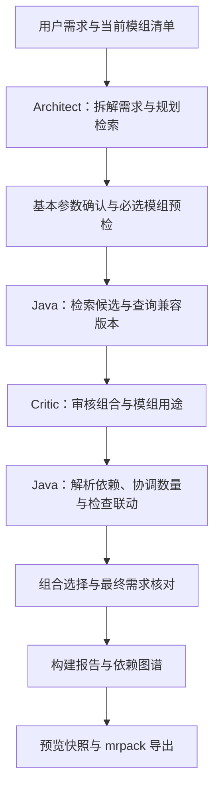

# MAA — Minecraft 整合包智能构筑系统

**用自然语言构筑 Minecraft 整合包。**

描述想玩的主题、核心模组和游戏版本，MAA 会从 Modrinth 搜索模组、筛选组合、补齐前置依赖，生成可导入启动器的 `.mrpack` 文件。也可以导入已有清单，在对话、模组列表和依赖图谱中继续调整。

Java 21 · Spring Boot 4 · LangChain4j · Vue 3

## 目录

- [使用示例：朝花夕拾](#使用示例朝花夕拾)
- [功能](#功能)
- [快速开始](#快速开始)
- [调整与导出](#调整与导出)
- [工作原理](#工作原理)
- [开发](#开发)
- [部署](#部署)
- [常见问题](#常见问题)

## 使用示例：朝花夕拾

想做一个以魔法和探索为主的冒险包，可以直接在对话框中输入：

```text
我想玩一个 NeoForge 1.21.1 的冒险整合包，名字是朝花夕拾，
大概 100～200 个模组，要求：

1. 以铁魔法为核心，多补充一些铁魔法的附属。
2. 包含 Alex 生物、Alex 洞穴、冰火传说、灾变、海灵物语、yagens-attributes。
3. 包含农夫乐事及其附属，特别是与包内已有模组的乐事联动附属。
4. 有丰富的群系和结构可以探险。
5. 有丰富的生物生态。
6. 丰富下界和末地生态。
7. 加入优化模组、现代化 UI 和修复。
8. 加入实用模组，例如苹果皮、JEI。
```

### 选择兼容的模组

遇到原项目没有适配版本的情况，MAA 会查找移植版、延续版或功能相近的项目，展示候选供选择。例如，这个需求中的 Alex 生物和 Alex 洞穴可以选择适配 NeoForge 1.21.1 的非官方移植版。候选会标明项目名称和关系，确认后继续构筑。

附属、世界生成和同定位模组也可以通过选择窗口调整：选择更喜欢的群系方案，保留需要的附属，或去掉不想叠加的内容。设置中可以分别开启或关闭这些窗口。

### 查看组合结果

这份需求的一次实际构筑生成了 **137 个模组文件，包括 93 个直接选入的模组和 44 个前置依赖**。其中的部分内容如下：

| 想玩的内容 | 组合中的模组举例 |
| --- | --- |
| 铁魔法及其扩展 | Iron's Spells 'n Spellbooks、Monsters Spellbooks、Apprentice's Codex、Cataclysm Spellbooks |
| 生物与战斗 | Alex 生物移植版、冰火传说、灾变、海灵物语 |
| 农夫乐事及联动 | Farmer's Delight、More Delight、Farmer's Spell；后者连接包内的铁魔法与农夫乐事 |
| 群系和探索结构 | Biomes O' Plenty、Moog's Voyager Structures、Alex 洞穴移植版 |
| 下界与末地 | Incendium、Nullscape |
| 优化与界面 | Sodium、Ferrite Core、ModernFix、Modern UI |
| 实用工具 | AppleSkin、JEI、ShulkerBoxTooltip、Inventory Profiles Next |

构筑完成后，对话中会展示各项需求对应的模组、数量和依赖问题。例如，“农夫乐事的包内联动”会关联到 Farmer's Spell 及其两个主体；缺少的内容或尚无法确认的要求也会列出，方便继续调整。

最后在图谱中查看依赖、勾选导出内容，下载 `.mrpack` 后交给支持该格式的启动器安装。模组选择会随版本、可用项目和个人选择变化；安装后可使用配套 [MAA-Checker](https://github.com/WaitMyDawn/MAA-Checker/releases) 检查客户端启动。

## 功能

- **自然语言构筑与修改**：指定主题、版本、加载器、数量和核心模组，也可以继续对话增删内容、调整要求。
- **中文名称与兼容候选**：解析常用别名，查询真实项目及版本，提供移植和替代方案。
- **附属与包内联动**：围绕核心寻找附属，结合包内已有模组选择联动内容。
- **依赖解析与需求核对**：自动补齐前置，检查版本约束与已知冲突，展示逐项需求的结果和缺口。
- **图谱与候选卡片**：查看依赖关系，搜索模组，跨页勾选候选并批量添加。
- **导入、历史与导出**：导入 `.mrpack` 清单，查看历史包版本，按预览结果导出。
- **个人设置**：保存模型 Key、模组偏好和黑名单，管理账号与对话历史。

## 快速开始

### 环境要求

- JDK 21。
- Node.js，用于构建时运行前端检查。前端使用原生 ES Modules，无需 `npm install`。
- 可访问 DeepSeek、Modrinth 和前端 CDN 的网络。
- 邮件服务，用于注册时发送邮箱验证码；支持 Resend、Brevo 和 SMTP。

### 本地运行

```powershell
git clone https://github.com/WaitMyDawn/Minecraft-AI-Agent.git
cd Minecraft-AI-Agent
Copy-Item .env.example .env
```

编辑 `.env`，按[环境变量模板](.env.example)配置加密密钥和邮件通道：

| 配置 | 说明 |
| --- | --- |
| `MAA_ENCRYPTION_SECRET` | 用于加密用户的 API Key，可通过 `openssl rand -base64 32` 生成随机值 |
| `MAA_ALLOW_REGISTRATION` | 是否开放注册，默认 `false`；需要注册新账号时设为 `true` |
| `MAA_MAIL_ENABLED` | 是否启用验证码邮件，需要注册时设为 `true` |
| `MAA_MAIL_PROVIDER` | 邮件通道：`resend`、`brevo` 或 `smtp`，同时填写模板中对应的通道配置 |

仓库自带 Maven Wrapper，直接启动：

```powershell
.\mvnw.cmd spring-boot:run
```

Linux / macOS 使用 `cp .env.example .env` 和 `./mvnw spring-boot:run`。

打开 [localhost:8080](http://localhost:8080)，注册并登录，在设置中填写个人 **DeepSeek API Key** 后即可开始构筑。默认模型为 `deepseek-chat`，模型调用使用个人 Key 的额度。

应用从工作目录加载 `.env`，已有 JVM 属性和进程环境变量优先。`DEEPSEEK_API_KEY` 是评测配置，日常构筑使用账号中保存的个人 Key。

### Docker 运行

先打包 JAR，再构建运行镜像：

```powershell
.\mvnw.cmd clean package
Copy-Item target/maa-app.jar maa-app.jar
docker build -t maa:latest .
docker compose up -d
docker compose ps
```

Compose 从 `.env` 加载配置，将 JAR、数据库和日志目录挂载到容器。服务默认监听宿主机 `127.0.0.1:8080`，可在本机访问，或通过反向代理提供 HTTPS 服务。

## 调整与导出

**继续对话。** 在已有包上提出“加入某个模组”“去掉某类内容”或新的玩法要求。修改会继承当前包的环境；需要切换版本或加载器时应明确说明。

**编辑图谱。** 查看模组及其前置依赖，搜索定位节点，或直接添加模组 slug。删除模组时注意依赖它的其它内容，按提示处理依赖链。

**挑选候选。** 在候选卡片中按类别、下载量等条件筛选，跨页勾选后批量加入。附属、兼容候选、世界生成和同定位内容的选择窗口可在设置中分别控制。

**查看历史版本。** 对话中的包版本入口对应当时的清单，可以回看并恢复先前的组合。

**导出清单。** 预览后勾选需要导出的文件，下载 `.mrpack`。导出时取消某个文件的勾选不会永久删除包内模组。依赖诊断会随结果展示，安装前应处理影响运行的问题。

已有 `.mrpack` 也可导入后继续编辑。导入支持 Modrinth 模组清单及其精确版本；包含配置、脚本、资源等覆盖文件的整合包暂不支持。

## 工作原理

MAA 将语义理解交给模型，将版本、依赖和文件处理交给 Java 代码。



**规划与审核。** Architect 将主题、点名模组、数量和玩法拆成结构化需求；Critic 根据候选资料审核组合和用途。两者使用独立提示词，输出 JSON，由 Java 校验后执行。

**按需求检查结果。** 每项要求关联实际选入的模组和版本。选择、依赖处理或数量调整后重新核对，保留未满足和待确认项，避免遗漏最初提出的要求。

**浏览器取数。** 默认由浏览器直接请求 Modrinth 元数据，服务端校验返回内容。批量查询与任务内复用减少重复请求；必要时在限定预算内由服务端补查，并统一限流。构筑期间应保持页面打开。

**任务调度。** 构筑通过有界队列执行，同一账号和会话有并发保护。等待用户选择时释放执行名额，确认后重新入队，支持取消。

**快照导出。** 预览时记录环境、模组版本和文件信息，导出使用同一份服务端快照，保持下载清单与预览一致。

## 开发

### 技术栈

| 部分 | 技术 |
| --- | --- |
| 后端 | Java 21、Spring Boot 4.0.5、虚拟线程 |
| 模型调用 | LangChain4j 1.18.1、DeepSeek Chat |
| 数据与缓存 | H2、Spring Data JPA、Caffeine |
| 前端 | Vue 3、原生 ES Modules、Tailwind CSS、Vis Network |
| 测试 | JUnit、Mockito、Node.js、Python |

### 项目结构

```text
src/main/java/yagen/waitmydawn/maa/
├── controller/   接口与构筑编排
├── service/      模型调用、检索、依赖、选择与导出服务
├── model/        领域规则、结构化契约、实体与 Repository
├── runtime/      请求上下文、任务、会话与并发管理
├── cache/        Modrinth 元数据缓存
└── logging/      日志与脱敏
src/main/resources/
├── application.properties
└── static/       页面、组件与 ES Modules
src/test/         Java 测试与固定数据
eval/             评测集、前端检查与评测工具
maa_db/           数据库、规则、别名与加载器目录
ops/backup.sh     备份脚本
```

### 构建与测试

```powershell
.\mvnw.cmd test
.\mvnw.cmd clean package
```

产物为 `target/maa-app.jar`。Maven 的 `test` 阶段会运行 Java 测试及前端检查；没有 Node.js 的环境可通过 `-DskipFrontendChecks=true` 跳过前端检查。

单独检查前端或报告工具：

```powershell
node eval/frontend-structure-check.mjs
node eval/fe-build-report-check.mjs
node eval/fe-build-progress-check.mjs
python -m unittest discover -s eval -p test_final_build_report.py -v
```

模型端到端评测需连接已启动的应用，使用专用测试账号。题集、运行参数和结果说明见 [eval/README.md](eval/README.md)。默认 `mvn test` 不运行这类实时评测。

模型端点和名称分别通过 `ai.api.url`、`ai.model-name` 配置。更换模型时，需要验证 JSON 输出、规划和审核契约以及异常重试行为。

## 部署

| 文件或目录 | 用途 |
| --- | --- |
| [.env.example](.env.example) | 环境变量模板 |
| [application.properties](src/main/resources/application.properties) | 应用配置与默认值 |
| [Dockerfile](Dockerfile) / [docker-compose.yml](docker-compose.yml) | 容器运行配置 |
| `maa_db/` | H2 数据库、规则、别名与加载器目录 |
| `maa_logs/` | Docker 部署时的日志目录 |
| [ops/backup.sh](ops/backup.sh) | 在线备份与冷备份 |

部署时需持久化数据库目录，并单独备份 `MAA_ENCRYPTION_SECRET`。用户 API Key 以密文保存，恢复数据库时需要使用原加密密钥。

Compose 使用 `prod` profile，运维端点在未配置 `MAA_OPS_TOKEN` 时关闭。`/api/health` 用于存活检查，`/api/health?strict=true` 用于就绪检查。修改 `.env` 后执行 `docker compose up -d` 更新容器配置。

应用使用单实例 H2 和进程内任务状态。重启前应留意正在进行的构筑和待确认操作；多实例部署需要额外处理数据存储、任务调度与会话共享。

## 常见问题

**数量是否包含前置依赖？**

可以按包含前置的总数、直接选入的模组数或新增数量提出要求。例如“包含前置共 100 个”或“再加 5 个模组”，结果中会显示对应计数。“朝花夕拾”示例的 137 个文件包含前置依赖。

**为什么需要选择移植版或替代模组？**

原项目可能没有适配目标环境的版本。移植版、延续版与原项目的维护者及内容可能不同，选择窗口提供项目信息，便于决定是否使用。

**生成的包能保证启动吗？**

依赖检查基于 Modrinth 元数据和已知规则，不能替代实际运行。导出后请在本机安装，使用 [MAA-Checker](https://github.com/WaitMyDawn/MAA-Checker/releases) 或客户端验证启动；性能、玩法和平衡也需要实际体验。

**能生成任务线或修改配方吗？**

目前专注于现有模组的搜索与组合，不生成任务线、KubeJS 或定制配置脚本。这些内容需要在生成的模组基础上另行制作。

---

许可条款见 [LICENSE.md](LICENSE.md)。模组及相关资源的版权与许可归各自作者所有。
